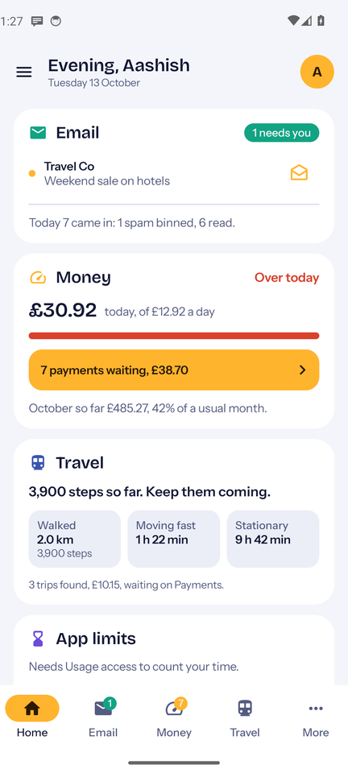
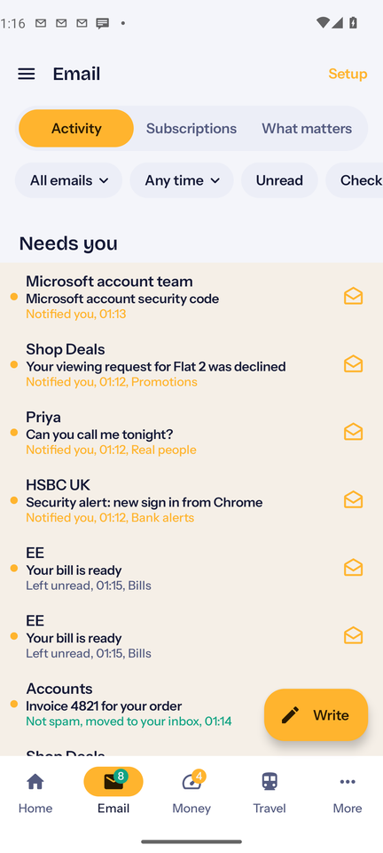
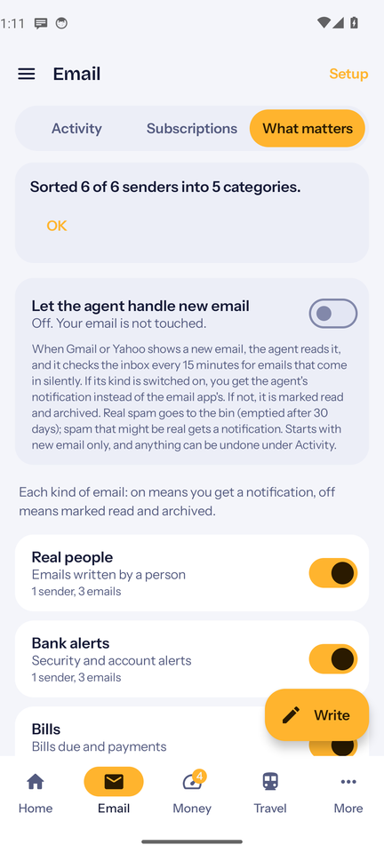
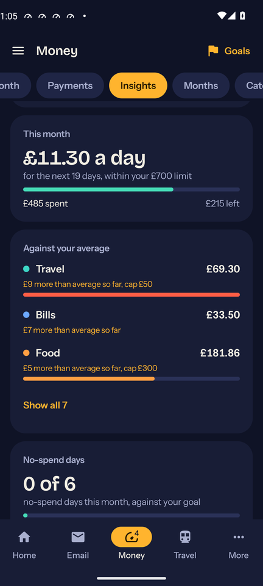
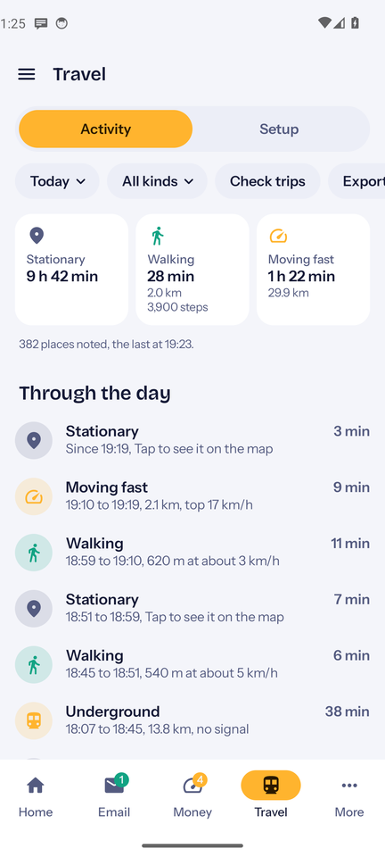
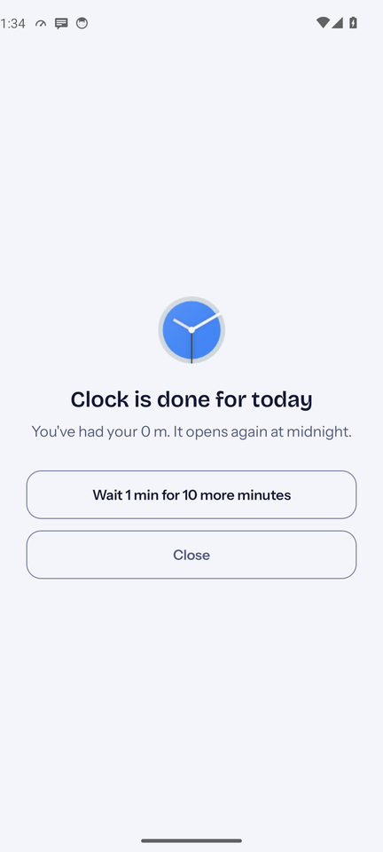
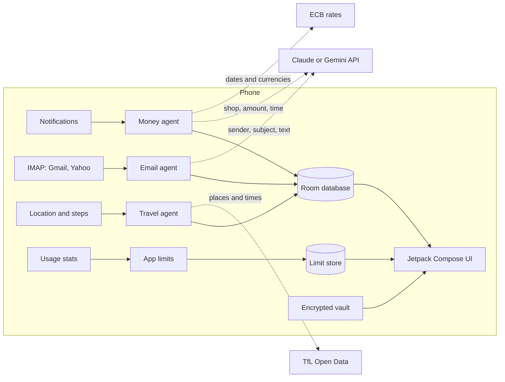

# Double O Broke

**A personal AI agent for Android that looks after money, email, travel fares, screen time and passwords.**
It runs on the phone, with no server and no login.

[](https://github.com/ash1009/DoubleOBroke/actions/workflows/build.yml)


| Home | Email | Email sorting |
|:---:|:---:|:---:|
|  |  |  |
| **Insights** | **Travel** | **App limits** |
|  |  |  |

<sub>Screenshots come from the automated UI test run, with made-up data.</sub>

## What it does

Each part of the app is an agent that does a job in the background and asks you only when it needs to.

### Money
- Reads bank payment notifications (HSBC UK, plus ICICI Bank SMS from India) and turns each one into a payment waiting for you to **Accept** or **Update**, straight from the notification.
- Guesses the category from your own past choices (same shop, similar names, time of day, amount). For a shop it has never seen, it asks an AI model: Claude first, Gemini when Claude can't answer.
- **Add by voice**: say "3.40 for the tube at Vauxhall" and it is saved, with the amount read on the phone and the category picked by AI.
- **Insights**: runway (how long your savings last), a daily allowance, categories against a usual month, no-spend days, regular payments and a year recap. Category caps send a nudge at 80% and when you go over.
- **Money in** from HSBC and Starling is listed on its own and never counted as spending. Money moved between your own accounts is a transfer: the two banks' alerts are paired by their shared reference (or your name), in whichever order they arrive. An equal amount alone is never enough.
- **Paid back:** money from a friend asks whether it pays you back for something. Pick the payment and it counts only your share everywhere (paid £60, £40 back: £20 spent).
- Other currencies are converted at that day's European Central Bank rate.

### Email
- Connects Gmail and Yahoo over IMAP with an app password.
- Reads who sent your newest emails and uses AI to group the senders into categories you can switch on or off.
- With the agent on, each new email is judged on what it says, not just who sent it: anything about you (a reply, a booking, an application, an account or money matter) reaches you, the rest is marked read and archived. Every action has an **Undo**.
- Spam check every few hours, a **Subscriptions** page that unsubscribes in one tap where the list allows it, and a **Needs you** list.
- Codes (OTP) always notify at once, with a **Copy code** button and no AI in the way.
- Read, reply, write and attach files inside the app.

### Travel
- Notes where the phone goes through the day (on the phone only) and works out tube, train and bus trips each night.
- A stretch with no position that ends far away is the tube, fast above ground is a train, and a short walk between trains near a station is a change.
- Stations, fares and routes come from **TfL Open Data**. Peak fares, the bus Hopper and the daily cap are applied, and the trips go to Money as payments waiting.
- A day timeline of **Stationary**, **Walking** and **Moving fast**, with steps from the phone's step counter.

### App limits
- A daily limit for any app, with a suggestion based on your usual week.
- Making limits stricter is instant. Loosening anything only starts the next day, after a wait and typing a sentence word for word. Turning it off is a 30 minute wait.
- A **way out** on the block screen: wait for 10 more minutes, and the wait doubles each time that day.
- A small service reads the phone's own record of which app is open (Usage access) about once a second while the screen is on, and puts the block screen over an app once its time is used. Device admin stops it being uninstalled.
- It deliberately uses no Accessibility: some banking apps (HSBC's among them) refuse to run while an app from outside Google Play has Accessibility switched on.

### Passwords
- A vault encrypted on the phone, opened with your fingerprint (or a master password on a new phone).
- Imports from Google Password Manager's export or from a plain note. Nothing in it ever goes to an AI or a server.

## How it works



Background work runs on **WorkManager** (nightly trip check, email checks, weekly backup) and a **NotificationListenerService** (bank alerts and new email). The UI is a single activity with Compose Navigation.

| Package | What's in it |
|---|---|
| `capture` | Notification listener, payment capture, money in and transfers, AI category guesses, voice entry |
| `domain` | Bank message parsers (HSBC, Starling, ICICI), transfer matching, categoriser, CSV import |
| `data` | Room database, preferences, backups, Claude and Gemini clients |
| `insights` | Runway, allowances, patterns, currency conversion |
| `mail` | IMAP client, inbox agent, prompts, OTP codes, notifications |
| `travel` | Location tracking, day timeline, trip finding, TfL client, fares |
| `limits` | Screen time maths, the watcher service, block screen, device admin |
| `vault` | Encryption and password import |
| `ui` | ViewModels, screens, components and theme |

## Privacy

- No server and no account. Data lives on the phone and in your own backups.
- API keys (Claude, Gemini) and email app passwords are pasted into the app and stay on the phone. They are never in backups or in this repository.
- Only what a job needs is sent: a shop name, place, amount and time to guess a category; an email's sender, subject and text to sort it; trip places and times to TfL.
- Location history stays on the phone for 30 days and is left out of backups.
- The password vault never leaves the phone unencrypted and is never sent to AI.

## Tech stack

- **Kotlin**, coroutines and Flow
- **Jetpack Compose** with Material 3, Navigation
- **Room**, **WorkManager**, Biometric
- **JavaMail** (android-mail) for IMAP and SMTP
- **Claude** and **Gemini** APIs, **TfL Open Data**, **Frankfurter** (ECB rates)
- **GitHub Actions** for builds and tests

## Build

You need JDK 17 and the Android SDK (API 35).

```bash
./gradlew assembleDebug        # build the app
./gradlew testDebugUnitTest    # run the unit tests
```

Release builds are signed with a key from the environment when one is given (`SIGNING_KEYSTORE`, `SIGNING_STORE_PASSWORD`, `SIGNING_KEY_ALIAS`, `SIGNING_KEY_PASSWORD`), and with the debug key otherwise.

## Tests

140 unit tests cover the parts with the most logic: bank message parsing, money in and transfer matching, category guessing, CSV import and backups, trip finding and fares, the day timeline, screen time maths and limit rules, email prompts and actions, and the vault's encryption and import.

During development, the app also ran on an Android emulator in CI, which tapped through it with made-up data and saved the screenshots above.

## About

A personal project by [Aashish Biradar](https://aashish-n-biradar.netlify.app), built with the help of an AI coding agent. It is shaped around my own banks, email accounts and London travel, so some parts (the HSBC and ICICI parsers, TfL fares) are specific to that.

Fonts: Bricolage Grotesque and Instrument Sans, under the SIL Open Font License (see `licenses/`).

Not affiliated with HSBC, Starling Bank, ICICI Bank, Google, Yahoo or Transport for London.
